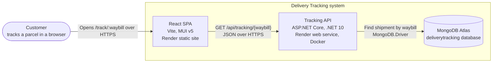
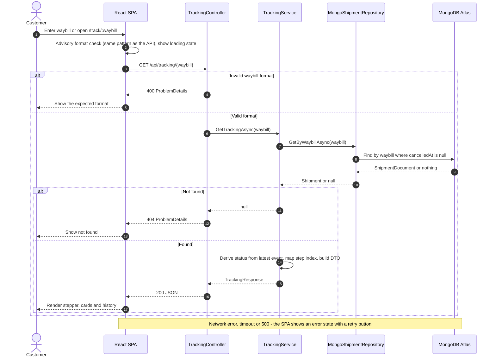

# Delivery Tracking

A single-page parcel-tracking app, built as a take-home for a junior developer role. Enter a waybill number and the page shows where the parcel is: a five-step progress bar (Order Packed, Processing, In Transit, Out for Delivery, then Delivered or Delivery Exception), the shipment and receiver details, and the full scan history.

The ASP.NET Core API (.NET 10) owns all delivery logic and stores shipments in MongoDB Atlas. The React client (Vite, MUI v5) only displays what the API returns.

- Search by waybill, with instant feedback on the format and six demo waybills to try
- Shareable links: `/track/WB10000004` opens that shipment and survives a refresh
- Times shown in South African time, whatever the viewer's time zone
- A vertical stepper and collapsible details on phones; a horizontal stepper and side-by-side cards on desktop
- Clear loading, not-found and error states, using the API's own error messages

## Live links

| | |
|---|---|
| App | https://delivery-tracking-web.onrender.com |
| API docs (Swagger UI) | https://delivery-tracking-api-ix66.onrender.com/swagger |
| Health check | https://delivery-tracking-api-ix66.onrender.com/health |

Demo waybills: `WB10000001` to `WB10000006`, one at each stage, with `WB10000006` showing a delivery exception.

**The first lookup can take up to a minute.** The API runs on Render's free plan, which puts it to sleep after 15 minutes without traffic. After 3 seconds the page says the server is waking up, then shows the result. The site itself is static and always loads straight away.

## Architecture



The API has three layers, and each has one job:

- **`TrackingController`** rejects a badly formatted waybill with a 400 and turns the service's answer into a status code. Nothing else.
- **`TrackingService`** holds the logic. It finds the shipment, works out its current status from the newest tracking event, maps that status to a step on the progress bar, and builds the response.
- **`IShipmentRepository`** loads shipments. `MongoShipmentRepository` reads MongoDB; the tests use an in-memory version, so they never touch a database.

A few rules hold everywhere:

- **The current status is derived, never stored.** It comes from the newest tracking event (latest timestamp; on a tie, the one recorded later), so it can't disagree with the history.
- **The step index is mapped in one place,** `StatusStepMapper`. The client uses the API's `stepIndex` and never calculates it.
- **Receiver phone numbers and street addresses never leave the API.** The response has the receiver's name and city only.
- **The domain classes know nothing about MongoDB.** The repository maps separate document classes to them.



The full class diagram is in [docs/diagrams.md](docs/diagrams.md).

### Repository layout

```
server/
  DeliveryTracking.Api/         Controllers, Services, Domain, Data (Mongo), Contracts, Validation
  DeliveryTracking.Api.Tests/   xUnit unit and integration tests, with an in-memory repository
  Dockerfile                    Multi-stage image for Render
client/
  src/                          pages, components, hooks, api client, mock data
docs/
  api-contract.md               Endpoints, errors and the MongoDB data model
  diagrams.md                   System, request-flow and class diagrams
render.yaml                     Render Blueprint for both services
DECISIONS.md                    Every design decision, with the reason for it
CLAUDE.md                       The rules the AI assistant worked under
```

## Key decisions

The full list, with a reason for each, is in [DECISIONS.md](DECISIONS.md). The most important:

| Decision | Why |
|---|---|
| Status derived from the newest event, never stored | One source of truth that can't drift from the history, matching how couriers send scan events |
| Step index mapped on the server by `StatusStepMapper` | The rule is written and tested once, in C#; the client just displays it |
| One MongoDB document per shipment, with its events embedded | One lookup by waybill returns everything the page needs |
| Unique index on the waybill; waybills stored uppercase | The database enforces uniqueness, and lookups are case-insensitive without a collation |
| Shipments are never deleted; removal sets `cancelledAt` | Keeps an audit trail; queries skip cancelled shipments |
| Errors as ProblemDetails: 400 for a bad format, 404 for an unknown waybill | One error shape everywhere, including unknown routes, and the client shows the API's own message |
| Receiver returned as name and city only | A public tracking page shouldn't expose phone numbers or addresses (POPIA) |
| Timestamps in UTC on the wire, shown in Johannesburg time | One unambiguous instant in the data; local time only for display |
| A mock mode in the client that returns the same data and errors as the API | The client can be built and tested without the API running, and can't hide an error-handling bug |
| `/health` pings MongoDB | Render takes an instance that can't reach the database out of service instead of letting it answer with 500s |

## Running locally

**You need:** the .NET 10 SDK, Node.js 24 (the version CI and Render use), and a MongoDB. Docker is the quickest way to get MongoDB; your own Atlas cluster works too.

### 1. Start MongoDB

```
docker run -d --name delivery-tracking-mongo -p 27017:27017 mongo:8
```

### 2. Run the API

From `server/`:

```
dotnet user-secrets set "Mongo:ConnectionString" "mongodb://localhost:27017" --project DeliveryTracking.Api
dotnet run --project DeliveryTracking.Api -- --seed
dotnet run --project DeliveryTracking.Api
```

- The first command stores the connection string in .NET user-secrets, outside the repo. To use Atlas instead, put your Atlas connection string there.
- `--seed` creates the six demo shipments and the unique index, then exits. Running it again resets the demo shipments.
- The API listens on http://localhost:5266, with Swagger UI at http://localhost:5266/swagger.

### 3. Run the client

From `client/`:

```
npm ci
cp .env.example .env.local
```

In `.env.local`, set `VITE_USE_MOCK=false` (it already points at `http://localhost:5266`). Then:

```
npm run dev
```

Open http://localhost:5173. The very first page load after `npm ci` can take a while, because Vite prepares the dependencies once.

The client must run on port 5173: in development the API only accepts cross-origin requests from `http://localhost:5173`, so Vite stops with an error if that port is taken instead of quietly moving to another.

**Client only:** leave `VITE_USE_MOCK=true` in `.env.local`, and the client answers from local mock data. No API or database needed.

## Running the tests

From `server/`:

```
dotnet test
```

From `client/`:

```
npm test
```

Neither suite needs a database or network access.

- **Server (xUnit, 88 tests):** the status and step-index rules, including the tie-break between events at the same time; the service's response building and privacy filtering; waybill validation and normalising; the document mapping and seed data. Integration tests run the real app in memory with `WebApplicationFactory` and check the JSON against the contract, the 400, 404 and 500 ProblemDetails, CORS, `/health` and the OpenAPI document.
- **Client (Vitest and React Testing Library, 89 tests):** the stepper for every status, including the exception step's red styling and the vertical layout on phones; the search box; every page state (loading, waking up, found, not found, error with and without retry); the data hook's cancellation and race handling; and date formatting in Johannesburg time. Tests run in a time zone far from South Africa's, so a formatter that loses its time zone fails, and any React warning fails a test.

GitHub Actions runs the server build and tests, and the client lint, tests and build, on every pull request and every push to `main`.

## API

The full contract, including the data model, is in [docs/api-contract.md](docs/api-contract.md).

### `GET /api/tracking/{waybill}`

A waybill is `WB` followed by 8 digits. Surrounding spaces and lowercase are accepted.

**200 OK** (events shortened to one)

```json
{
  "waybill": "WB10000004",
  "status": "OutForDelivery",
  "stepIndex": 3,
  "isException": false,
  "exceptionReason": null,
  "receiver": { "name": "T. Mokoena", "city": "Johannesburg" },
  "estimatedDelivery": "2026-10-09",
  "lastUpdated": "2026-10-08T05:42:00+00:00",
  "events": [
    {
      "status": "OutForDelivery",
      "description": "Parcel out for delivery",
      "location": "Midrand Depot",
      "timestamp": "2026-10-08T05:42:00+00:00"
    }
  ]
}
```

**400 Bad Request**

```json
{
  "type": "https://tools.ietf.org/html/rfc9110#section-15.5.1",
  "title": "Invalid waybill format",
  "status": 400,
  "detail": "A waybill is WB followed by 8 digits, for example WB10000004."
}
```

**404 Not Found**

```json
{
  "type": "https://tools.ietf.org/html/rfc9110#section-15.5.5",
  "title": "Shipment not found",
  "status": 404,
  "detail": "No shipment was found for waybill WB99999999."
}
```

Error responses also carry a `traceId`. An unexpected failure returns a 500 ProblemDetails with no internal details.

### `GET /api/tracking`

The waybills of all active shipments, sorted, so there's something to try:

```json
["WB10000001", "WB10000002", "WB10000003", "WB10000004", "WB10000005", "WB10000006"]
```

This only makes sense while the database holds demo data; a real system wouldn't list every tracking number.

### `GET /health`

`200 Healthy` when the API can reach MongoDB, `503 Unhealthy` when it can't. Render uses it to decide whether the service is up.

## Trade-offs and what I'd do next

This is sized for a take-home. For production I would add:

- **Authentication**, and an admin area with role-based access for staff to create shipments and record events. Today the API is read-only and data comes from the seed.
- **Courier webhooks or a message queue for scan events,** so updates are pushed in as they happen. The event-history model already fits: a new scan is a new event, and the status follows.
- **Caching** of tracking responses for a short time, cleared when a new event arrives, since popular parcels are looked up repeatedly.
- **Rate limiting** on the lookup endpoint, so nobody can work through the waybill range, and removing the demo `GET /api/tracking` list.
- **Logging and monitoring:** structured logs, request tracing and alerts on the health check, instead of reading Render's logs.
- **Tighter hosting:** a paid instance with no cold start, and private networking or an IP allow-list for the database. The demo allows any IP address in Atlas and relies on a least-privilege database user with a strong password.

## How I used AI

I built this with Claude Code, Anthropic's AI coding assistant, and used OpenAI's Codex as a second, independent reviewer. I reviewed every change, and I may not be able to explain every line in detail, however I made sure to learn every step of the way, seek to understand and tried to keep a clean working history. Ive made my own personal notes for further study and learning.

How the work was controlled:

- **Written rules.** [CLAUDE.md](CLAUDE.md) holds the architecture rules, coding style and workflow the assistant had to follow, and it's committed so anyone can see what it was told.
- **Plan first, then small steps.** The project was split into ten parts. Each one started with a plan that I approved, then went in small changes. After each change Claude ran the build and tests and showed me the results; I read the diff, then staged and committed it myself.
- **The history is mine.** [.claude/settings.json](.claude/settings.json) has permission rules that block Claude from running `git commit`, `git push` and `gh pr merge`. Every commit and merge was made by me.
- **Disclosure.** Every commit the assistant contributed to carries a `Co-Authored-By` trailer, and every pull request has an "AI assistance" section saying what it did and what I changed.
- **Checks before every merge.** From Part 2 on, GitHub Actions built and tested every pull request. Before each merge, a separate review ran in a fresh context that hadn't seen the reasoning behind the code: Claude Code's reviewer agent and `/code-review` in the early parts, then Codex. The Codex reviews included mutation testing, deliberately breaking the code to see whether any test noticed.

That process caught real problems:

- After one part reported 66 passing tests and a passing build, the page was blank in the browser. Icon imports that worked in the test runner failed under Vite. Since then, every interface change has also been checked in a real browser before I reviewed it.
- Codex found three bugs that the integration tests missed: a whitespace-only waybill got a generic validation error instead of our 400, browsers got plain-text errors for unknown routes, and the OpenAPI document described statuses as numbers while the API sent strings. Each was reproduced with a failing test before it was fixed.
- Mutation testing showed the tests were sometimes weaker than their pass count suggested. In one part, 32 of 38 deliberate breaks went unnoticed, including a stepper that worked out its own step index and still passed every test. The tests were strengthened until those breaks failed.

Some suggestions were rejected after checking them, and the reason is recorded in [DECISIONS.md](DECISIONS.md) or the pull request.
