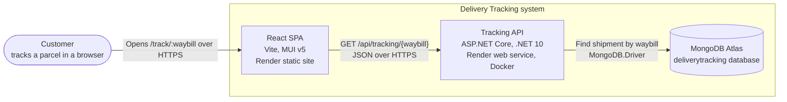
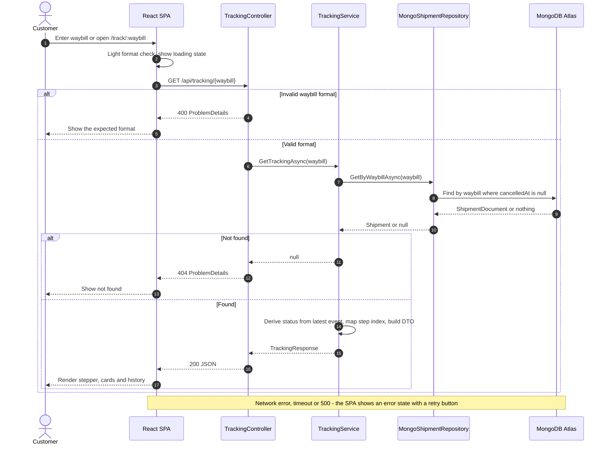
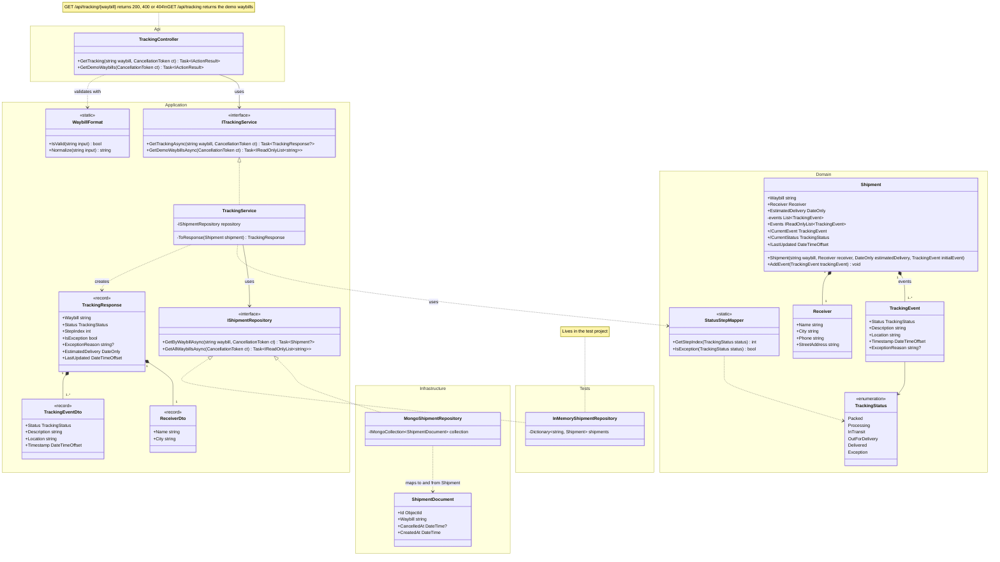

# Diagrams

GitHub renders these Mermaid diagrams directly. To export one as an image, paste it into [mermaid.live](https://mermaid.live).

## System overview

## Request flow

## Backend classes

Notation: `/` marks a derived value (computed, never stored), `1..*` means a shipment always has at least one event, and `Phone` and `StreetAddress` never leave the API because `ReceiverDto` doesn't include them.
